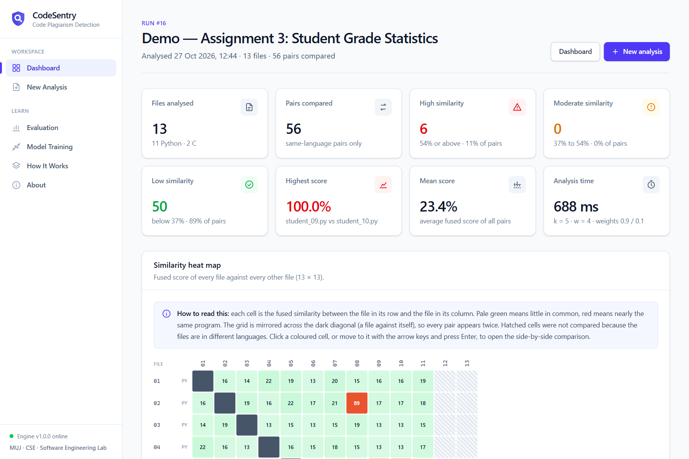
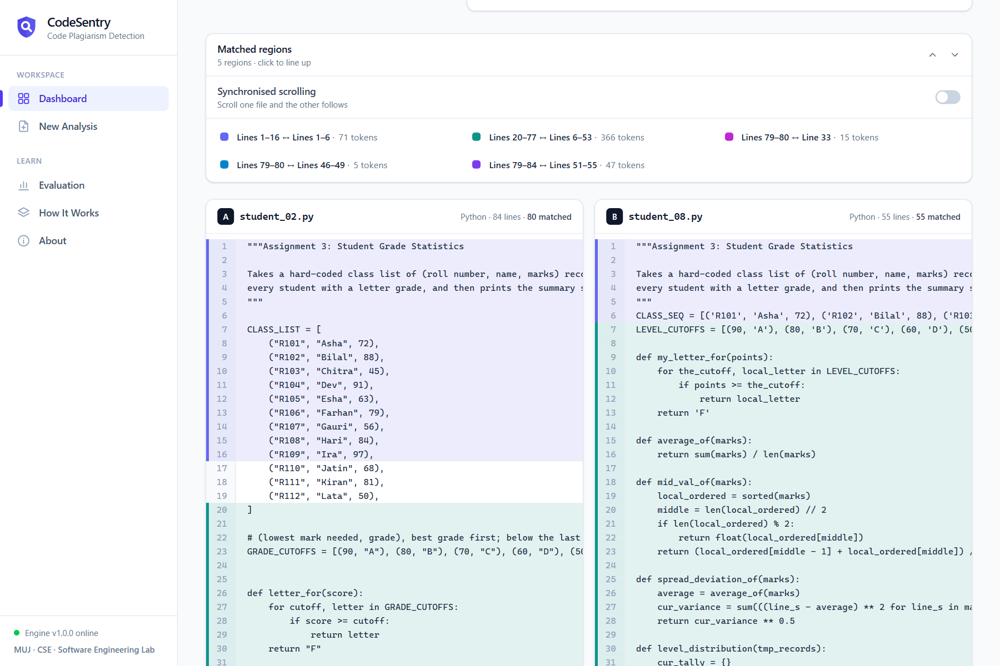
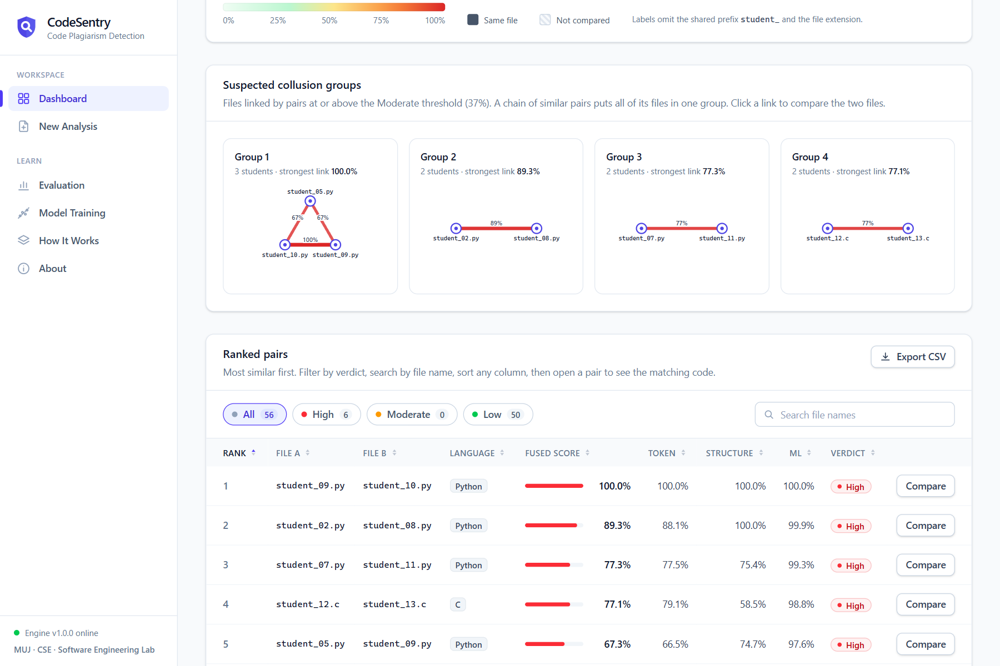
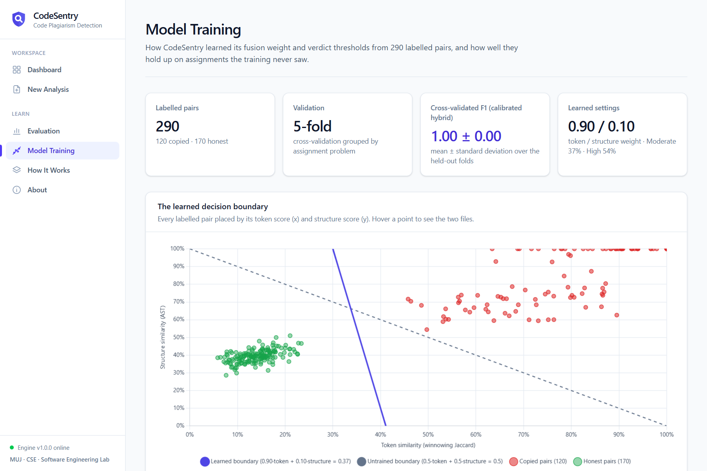
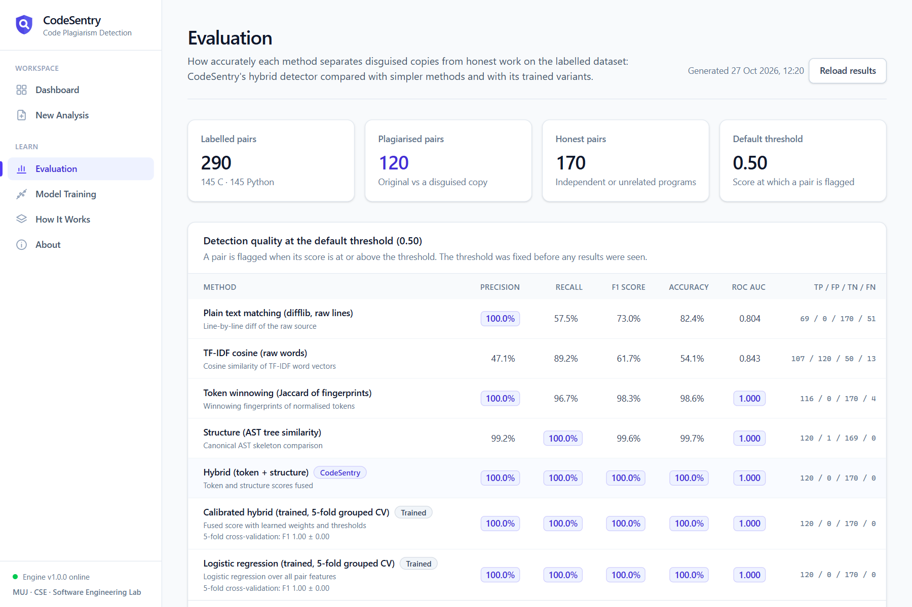
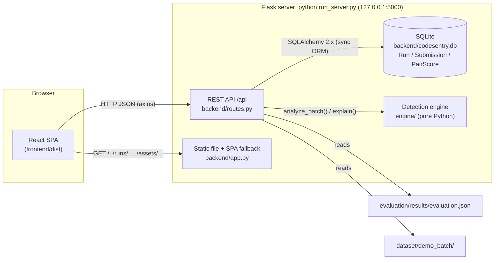

# CodeSentry: Source-Code Plagiarism Detection for Python and C

CodeSentry is a web application that finds plagiarism in programming assignments. A teacher uploads
the submissions of a whole class (Python `.py`, C `.c`/`.h`, or a `.zip` of them), and CodeSentry
compares every pair of submissions written in the same language. It combines two independent
signals: **token fingerprinting** (winnowing over a normalised token stream) and **structural
comparison** of abstract syntax trees (Zhang–Shasha tree edit distance plus shared subtrees). The
two scores are fused into one similarity score with a High / Moderate / Low verdict. Results appear
as a heat map, a score histogram and a ranked list of pairs, and each pair opens a side-by-side view
with the matching code highlighted. The detection engine is plain Python with no machine-learning
libraries, so every formula can be followed and explained. Its decision layer is **trained** on a
labelled dataset of 290 program pairs: the fusion weights and verdict thresholds are learned, and a
logistic-regression model adds a probability of plagiarism to every pair, both validated with
grouped cross-validation on assignment problems the model never saw. The whole system runs offline
on one computer.

| Run results (heat map) | Side-by-side evidence |
|---|---|
|  |  |
| **Suspected collusion groups** | **Model training: the learned decision boundary** |
|  |  |



---

## Contents

1. [The problem](#1-the-problem)
2. [Features](#2-features)
3. [Architecture](#3-architecture)
4. [The detection pipeline](#4-the-detection-pipeline)
5. [Tech stack](#5-tech-stack)
6. [Folder structure](#6-folder-structure)
7. [Setup and run](#7-setup-and-run)
8. [Using CodeSentry](#8-using-codesentry)
9. [REST API](#9-rest-api)
10. [Dataset, evaluation and training](#10-dataset-evaluation-and-training)
11. [Tests](#11-tests)
12. [Team and license](#12-team-and-license)

---

## 1. The problem

Students who copy code rarely hand it in unchanged. Common disguises are:

| Disguise | Example |
|---|---|
| Renaming identifiers | `total` becomes `s`, `average()` becomes `mean_score()` |
| Reformatting and rewriting comments | different indentation, blank lines and brace style; comments removed or reworded |
| Reordering | the same functions defined in a different order |
| Rewriting control flow | a counted `for` loop turned into an equivalent `while` loop |
| Inserting dead code | unused variables and a helper function that is never called |

Text-based checkers (line diffs such as `diff`, or word-frequency measures such as TF-IDF cosine)
compare the characters or words of the files. Every one of these edits changes those characters,
so the similarity of a disguised copy falls even though the program is the same. A renamed copy can
share almost no identical lines with the original. At the same time, two honest solutions to the same
assignment can share many words (`for`, `range`, `marks`, `print`) and look more similar than they
are.

CodeSentry compares what does not change under these edits:

* the **sequence of token kinds** after normalisation, where every identifier becomes `ID` and every
  number `NUM`, and comments and layout are removed, so renaming and reformatting cannot affect it;
* the **shape of the syntax tree**, with names and literal values removed, every loop form mapped to
  the same `Loop` node and top-level definitions put into a canonical order, so reordering functions
  or swapping `for` for `while` changes it very little.

## 2. Features

* **Batch analysis** of a whole class: every same-language pair is compared (n files give
  n(n−1)/2 comparisons). Python and C files can be mixed in one upload.
* **Hybrid detection**: winnowing fingerprints (token level) fused with AST structural similarity
  (syntax-tree level).
* **Uploads**: individual files or `.zip` archives, up to 200 files and 2 MB per file. Unsafe
  archive paths are rejected, and a file that cannot be parsed is reported with a warning instead
  of stopping the run.
* **Adjustable settings** for each run: k-gram length `k`, winnowing window `w`, and the
  token/structure fusion weights.
* **Results dashboard**: summary cards, an interactive similarity **heat map**, a **histogram** of
  scores and a sortable, filterable **ranked pairs table** that can be exported as **CSV**.
* **Suspected collusion groups**: files linked by pairs at or above the Moderate threshold are
  grouped with union-find, so a chain of copying (A–B, B–C) appears as one group. Each group is drawn
  as a small network, and clicking a link opens that pair.
* **Model Training** page: a scatter plot of all labelled pairs (token score against structure
  score) with the learned decision boundary, the cross-validation folds, the logistic-regression
  coefficients, and a comparison of all methods on held-out pairs.
* **Pair view**: the two files side by side with the matched regions highlighted in the same colour
  in both files, plus a breakdown of every score (token, containment, structure, tree edit
  similarity, subtree overlap, fused) next to two naive baselines (plain text diff and TF-IDF
  cosine) for contrast.
* **How It Works** page: paste two snippets and step through what each pipeline stage produces
  (tokens, normalised symbols, k-grams, fingerprints, skeleton trees, final score), computed by the
  real engine.
* **Evaluation** page: precision, recall, F1, accuracy and ROC AUC of the hybrid method and four
  simpler methods on a labelled dataset of disguised and honest pairs.
* **Persistent history**: runs are stored in SQLite and can be reopened or deleted from the
  dashboard.
* **Works offline**: no CDNs, web fonts or remote calls. The built interface is served by the same
  Flask process as the API.

## 3. Architecture



* **Frontend** (`frontend/`): a React single-page application. In production it is built once
  into `frontend/dist`, and Flask serves it. Every page gets its data only from the REST API.
* **Backend** (`backend/`): Flask application factory, REST routes, validation of uploads and zip
  archives, JSON error handling, and storage through SQLAlchemy.
* **Engine** (`engine/`): the detection algorithms. It has no web or database code, so the
  evaluation scripts and the tests call exactly the same functions as the web app.
* **Dataset and evaluation** (`dataset/`, `evaluation/`): a labelled benchmark and the script that
  measures every method on it.

## 4. The detection pipeline

```
 source file ──► 1 Normalise ──► 2 Tokenise ──► 3 Winnowing fingerprints ──► token score (Jaccard)
                                       │                                              │
                                       └────────► 4 AST skeleton ──► structure score ─┤
                                                                                      ▼
                                                                 5 Weighted fusion ──► verdict
```

Default parameters (`engine/models.py`, `EngineConfig`):

| Parameter | Default | Meaning |
|---|---|---|
| `k` | **5** | k-gram length, in normalised tokens |
| `w` | **4** | winnowing window size |
| `w_token` | **0.5** | fusion weight of the token score |
| `w_structure` | **0.5** | fusion weight of the structure score |
| `high_threshold` | **0.75** | fused score at or above which the verdict is High |
| `moderate_threshold` | **0.50** | fused score at or above which the verdict is Moderate |
| `ted_node_cap` | **200** | largest tree compared with exact Zhang–Shasha; larger trees use the approximation |

These are the built-in defaults. If `engine/trained_config.json` exists, its learned weights and
thresholds replace them for new runs (see *Optional trained settings* below). The values actually
in use are returned by `GET /api/config/defaults` and shown on the New Analysis and How It Works
pages.

**Stage 1: Normalisation.** The language is detected from the extension (`.py` is Python; `.c`
and `.h` are C). Line endings are unified, and each file is prepared once per batch and reused for
all of its pairs.

**Stage 2: Tokenisation and normalisation.** Python is tokenised with the standard `tokenize`
module, and C with a hand-written longest-match lexer that handles comments, preprocessor lines,
string and character literals, number formats and C11 keywords. The normaliser then maps each
token to a canonical symbol: identifiers become `ID`, numbers `NUM`, strings `STR` and characters
`CHR`. Keywords and operators keep their text, Python `INDENT`/`DEDENT` are kept, and comments and
preprocessor directives are removed. After this step, renaming variables or rewriting comments
cannot change the symbol stream.

**Stage 3: k-gram winnowing fingerprints and Jaccard similarity**
(Schleimer, Wilkerson and Aiken, 2003).
Every run of `k = 5` consecutive symbols (a k-gram) is hashed to 64 bits with BLAKE2b. A window of
`w = 4` consecutive hashes slides over the sequence, and the minimum hash of each window is kept as
a fingerprint (on ties, the rightmost one is kept). This guarantees that any shared run of at least
`w + k − 1 = 8` tokens is detected, while matches shorter than `k` tokens are ignored as noise.

* **Token score** = Jaccard similarity of the two fingerprint sets, |A ∩ B| / |A ∪ B|.
* **Containment** = |A ∩ B| / min(|A|, |B|). It shows how much of the smaller file appears in the
  larger one (reported, not fused).
* **Matched regions**: shared fingerprints are mapped back to source line ranges and merged. These
  are the highlighted blocks in the pair view.

Very short files fall back to `k_eff = max(2, min(len_a, len_b))`.

**Stage 4: AST skeleton, Zhang–Shasha tree edit distance and subtree similarity.**
Python is parsed with `ast` and C with tree-sitter. The syntax tree is reduced to a *skeleton* of
canonical labels (`Function`, `Loop`, `If`, `Assign`, `Call`, `BinOp`, `Compare`, operator leaves
such as `Add`, ...). Identifier names, literal values, docstrings and comments are dropped, and every
loop form (`for`, `while`, `do`) becomes `Loop`. The top-level definitions are sorted into a
canonical order, so the order in which functions are written does not matter.

* **Tree edit similarity** = 1 − TED(A, B) / max(|A|, |B|), where TED is the classic
  Zhang–Shasha (1989) tree edit distance with unit costs for insert, delete and relabel. For trees
  larger than `ted_node_cap = 200` nodes, the edit distance of the pre-order label sequences is used
  instead (bit-parallel Myers/Hyyrö algorithm). It is a known lower bound of the tree edit distance.
* **Subtree similarity** = multiset Jaccard of the hashes of all subtrees,
  Σ min(count) / Σ max(count). It rewards shared building blocks wherever they appear.
* **Structure score** = 0.5 × tree edit similarity + 0.5 × subtree similarity.

**Stage 5: Weighted fusion and verdict.**

```
fused = (w_token × token + w_structure × structure) / (w_token + w_structure)      (defaults 0.5 / 0.5)
verdict = High      if fused ≥ 0.75
          Moderate  if fused ≥ 0.50
          Low       otherwise
```

If a file cannot be parsed into a tree, the token score is used on its own (with a warning) rather
than counting the missing structure score as 0. The verdict ranks pairs for a human reviewer to
check. It is not proof of plagiarism.

**Baselines (for comparison only).** Each pair also gets two naive scores that do not affect the
verdict: a plain-text line diff (`difflib.SequenceMatcher` ratio) and the TF-IDF cosine similarity
of the raw words. The evaluation uses them to show what CodeSentry adds.

**Optional trained settings.** If `engine/trained_config.json` exists (written by
`training/train_model.py`), the server uses its learned fusion weights and thresholds as the
defaults for new runs. Values typed on the New Analysis page still take precedence, and every run
stores the exact settings it used. If `engine/trained_model.json` exists, every pair also shows
`ml_probability`, the plagiarism probability from a logistic-regression model trained on the
labelled pairs. It appears as an *ML* column in the pairs table and as a row in the pair view. This
is an extra signal; the verdict still comes from the fused score. Both files are read when the
server starts, so restart it after retraining.

## 5. Tech stack

| Layer | Technology |
|---|---|
| Detection engine | Python 3.11 standard library (`tokenize`, `ast`, `hashlib`, `difflib`); `tree-sitter` + `tree-sitter-c` for parsing C |
| Backend | Flask 3.1, flask-cors 6, SQLAlchemy 2.0 (synchronous ORM), SQLite |
| Frontend | React 19, Vite 8, React Router 7, Tailwind CSS 4, Chart.js 4 with react-chartjs-2, axios |
| Testing | pytest 9 |
| Tooling | Node.js 20+ and npm (only needed to rebuild the frontend) |

## 6. Folder structure

```
CodeSentry/
├── run_server.py            start the web app (API + built frontend)
├── requirements.txt         pinned Python dependencies
├── engine/                  detection engine (pure Python)
│   ├── models.py            Token, SourceFile, Fingerprint, Node, MatchRegion, EngineConfig
│   ├── lang.py              language detection from the file extension
│   ├── tokenizer_python.py  Python tokens (stdlib tokenize)
│   ├── tokenizer_c.py       C tokens (hand-written lexer)
│   ├── normalizer.py        canonical symbol stream (ID, NUM, STR, ...)
│   ├── winnowing.py         k-gram hashing, winnowing, Jaccard, containment, match regions
│   ├── structure_common.py  canonical AST labels shared by both languages
│   ├── structure_python.py  Python skeleton (ast)
│   ├── structure_c.py       C skeleton (tree-sitter)
│   ├── tree_similarity.py   Zhang–Shasha TED, pre-order approximation, subtree bag similarity
│   ├── baselines.py         plain-text and TF-IDF baselines
│   ├── fusion.py            weighted fusion and verdict
│   └── pipeline.py          analyze_pair, analyze_batch, explain
├── backend/
│   ├── app.py               Flask application factory, SPA serving, JSON errors
│   ├── config.py            default settings (database URL, upload limits, paths)
│   ├── db.py                SQLAlchemy models: Run, Submission, PairScore
│   ├── routes.py            REST API under /api
│   └── ml.py                optional trained-model probability
├── frontend/
│   ├── src/                 React source (pages/, components/, api/client.js, lib/)
│   └── dist/                production build served by Flask (committed)
├── dataset/
│   ├── problems/pNN_*/      10 assignments x (original + 2 independent solutions) x {Python, C}
│   ├── demo_source/         honest solutions used to build the demo class
│   ├── obfuscator.py        rename, comments_format, reorder, loop_swap, dead_code, combined
│   └── build_dataset.py     builds generated/, labels.json and demo_batch/
├── evaluation/
│   ├── evaluate.py          scores every labelled pair with all five methods
│   └── results/             evaluation.json, pair_scores.csv, summary.md
├── training/                optional: learns fusion weights, thresholds and a logistic model
├── tests/                   pytest suite
└── docs/
    └── ARCHITECTURE_CONTRACT.md   interfaces, data formats and API specification
```

## 7. Setup and run

Requirements: **Python 3.11+**. Node.js 20+ is needed only if you rebuild the interface, because
`frontend/dist` is already in the repository.

```bash
# 1. Python environment
python -m venv .venv
.venv\Scripts\activate            # Windows
# source .venv/bin/activate       # macOS / Linux
pip install -r requirements.txt

# 2. Web interface (optional: a built copy is committed in frontend/dist)
cd frontend && npm install && npm run build && cd ..

# 3. Start the server, which opens http://127.0.0.1:5000 in your browser
python run_server.py
```

Options: `python run_server.py --port 8080` uses another port, and `--no-browser` stops the
browser from opening. The server listens on `127.0.0.1` only. The SQLite database
`backend/codesentry.db` is created automatically on first start.

To build the demo class and the evaluation results:

```bash
python dataset/build_dataset.py      # dataset/generated/, dataset/labels.json, dataset/demo_batch/
python evaluation/evaluate.py        # evaluation/results/evaluation.json, pair_scores.csv, summary.md
```

For frontend development with hot reload, run `npm run dev` in `frontend/` (port 5173). Vite
forwards `/api` requests to the Flask server on port 5000.

## 8. Using CodeSentry

1. **Dashboard**: click **Run demo analysis** to analyse a prepared class (*Assignment 3: Student
   Grade Statistics*), in which some disguised copies are hidden among honest solutions. Or start a
   **New analysis**. Earlier runs are listed here and can be reopened or deleted.
2. **New Analysis**: drag in the students' files or a `.zip` archive. You can name the run and
   open **Advanced settings** to change `k`, `w` and the token/structure weights. Click **Analyze
   submissions**.
3. **Run results**: the summary cards give the number of files and pairs, the High/Moderate/Low
   counts, and the highest and mean scores. The **heat map** shows every file against every other
   file (darker red means more similar; click a cell to open that pair). The **histogram** shows how
   the scores are spread. The **ranked pairs** table lists the most similar pairs first and can be
   filtered by verdict, searched by file name and sorted.
4. **Pair view**: the two submissions side by side. Matched regions have the same colour in both
   files; click a region to line the files up. The score breakdown shows each signal next to the
   naive baselines. *Swap sides* exchanges the two files.
5. **How It Works**: edit or paste two snippets and click **Run step by step** to see the tokens,
   normalised symbols, k-grams, fingerprints, skeleton trees and the final score for your input.
6. **Evaluation**: how accurately each method separates disguised copies from honest pairs on the
   labelled dataset.
7. **Model Training**: where the learned weights and thresholds come from. The scatter plot shows
   every labelled pair and the learned boundary line; the tables show each cross-validation fold
   and the scores on held-out pairs.

On the Run results page, **Suspected collusion groups** shows which students are linked by
suspicious pairs, and **Export CSV** downloads the ranked pairs for a spreadsheet.

## 9. REST API

All endpoints are under `/api` and return JSON. Errors are returned as `{"error": "<message>"}`
with status 400 (invalid input), 404 (not found), 413 (too large) or 500.

| Method | Path | Description |
|---|---|---|
| GET | `/api/health` | `{"status": "ok", "version": "1.0.0", "languages": ["python", "c"]}` |
| GET | `/api/config/defaults` | default engine settings (`k`, `w`, `w_token`, `w_structure`, thresholds, `ted_node_cap`), plus `trained` (and `meta` when trained settings are loaded) |
| POST | `/api/runs` | multipart upload: `files` (repeated; `.py`, `.c`, `.h` or `.zip`), optional `name`, `k`, `w`, `w_token`, `w_structure`. Analyses synchronously and returns **201** with a RunSummary |
| POST | `/api/runs/demo` | analyses `dataset/demo_batch/` and returns **201** with a RunSummary (404 if the demo batch has not been built) |
| GET | `/api/runs` | all runs (RunSummary list), newest first |
| GET | `/api/runs/<id>` | RunSummary plus `files`, `matrix` (fused scores, `null` for pairs that were not compared), `pairs` (ranked PairResults without source text), `config` and `clusters` (suspected collusion groups: `members`, `edges`, `max_score`) |
| GET | `/api/runs/<id>/pairs/<a_id>/<b_id>` | one PairResult with `a_source` and `b_source`. The order does not matter: `/2/1` returns the same pair with the sides swapped |
| DELETE | `/api/runs/<id>` | deletes a run with its submissions and scores (**204**) |
| POST | `/api/explain` | JSON `{"code_a", "code_b", "language": "python" or "c"}`; returns every intermediate stage and the PairResult (400 if a snippet cannot be tokenised) |
| GET | `/api/evaluation` | contents of `evaluation/results/evaluation.json` (404 if not generated yet) |
| GET | `/api/training` | `report` (`training/results/training_report.json`), `points` (token and structure score, label and category of every labelled pair) and `trained` (`engine/trained_config.json`); 404 if training has not been run |

A **RunSummary** has `id`, `name`, `created_at` (ISO 8601), `file_count`, `pair_count`, `high`,
`moderate`, `low`, `max_score`, `mean_score` and `elapsed_ms`. A **PairResult** has the two file ids
and names, `language`, `scores` (`token`, `containment`, `structure`, `ted`, `subtree`, `fused`,
`text_baseline`, `tfidf_baseline`, and `ml_probability` when a trained model is present),
`verdict`, `matches` (line ranges in both files), `stats` and `warnings`. The full formats are in
[`docs/ARCHITECTURE_CONTRACT.md`](docs/ARCHITECTURE_CONTRACT.md).

Upload limits: 200 files per analysis, 2 MB per file, 60 MB per request, and at least 2 supported
source files. Zip archives skip directories, `__MACOSX/` entries, hidden files and unsupported
extensions, and reject paths that try to leave the archive. Duplicate file names get a numeric
suffix.

## 10. Dataset, evaluation and training

> **Results** (290 labelled pairs: 120 disguised copies, 170 honest pairs; untrained methods at the
> fixed threshold 0.50, trained methods scored only on problems held out of training). Full tables
> — recall per obfuscation type, false-positive rate per negative category, timing — are in
> **[`evaluation/results/summary.md`](evaluation/results/summary.md)** and
> **[`training/results/summary.md`](training/results/summary.md)**, and on the app's **Evaluation**
> page. Every number is written by the scripts; none are typed in by hand.
>
> | Method | Precision | Recall | F1 | ROC AUC |
> |---|---|---|---|---|
> | Plain text matching | 1.000 | 0.575 | 0.730 | 0.804 |
> | TF-IDF cosine | 0.471 | 0.892 | 0.617 | 0.843 |
> | Token winnowing | 1.000 | 0.967 | 0.983 | 1.000 |
> | AST structure | 0.992 | 1.000 | 0.996 | 1.000 |
> | **Hybrid (token + structure)** | 1.000 | 1.000 | 1.000 | 1.000 |
> | **Calibrated hybrid (trained, 5-fold grouped CV)** | 1.000 | 1.000 | 1.000 | 1.000 |
> | **Logistic regression (trained, 5-fold grouped CV)** | 1.000 | 1.000 | 1.000 | 1.000 |
>
> Every single method fails somewhere — plain text catches none of the fully disguised copies,
> TF-IDF flags 78 % of honest solutions to the same assignment, token winnowing misses 20 % of the
> fully disguised copies, AST structure raises one false alarm — and the hybrid covers each blind
> spot. The dataset is synthetic and its disguises are mechanical, so these figures show the
> relative strength of the methods, not the accuracy to expect on real classes.

**Dataset.** There are ten assignment problems (grade statistics, matrix operations, prime numbers,
string analysis, bank account, sort and search, bracket checker, base conversion, inventory
billing, temperature series), each written in both Python and C. For every problem and language
there is an `original` solution and two `independent` solutions, written as different students
would write them, with different algorithms, decomposition and naming.
`python dataset/build_dataset.py` applies six automatic obfuscations to each original: `rename`,
`comments_format`, `reorder`, `loop_swap`, `dead_code` and `combined` (all five in sequence). Every
generated program is checked to be valid code. The script then writes the labelled pairs to
`dataset/labels.json`:

* **Positives (plagiarised):** each original against each of its six disguised variants.
* **Negatives (honest):** original against each independent solution, the two independent
  solutions against each other, the fully disguised variant against an independent solution, and
  originals of different problems against each other.

**Evaluation.** `python evaluation/evaluate.py` scores every labelled pair with five methods: plain
text diff, TF-IDF cosine, token winnowing alone, AST structure alone, and the CodeSentry hybrid. For
each method it reports the confusion matrix, precision, recall, F1 and accuracy at the fixed
default threshold 0.50; the best-F1 threshold, labelled as tuned on the same data; ROC AUC
(Mann–Whitney rank formula); recall for each obfuscation type; false-positive rate for each negative
category; and the mean time per pair.

**Training.** `python training/train_model.py` learns the decision layer from the labelled pairs. It
computes eight similarity features per pair with the real engine (token Jaccard, containment,
structure, tree edit similarity, subtree overlap, plain-text ratio, TF-IDF cosine, length ratio) and
trains two models:

* **Calibrated hybrid** — keeps the explainable formula `fused = w·token + (1 − w)·structure` and
  learns `w` and the decision threshold by grid search (best F1, then the widest margin between
  honest pairs and copies).
* **Logistic regression** — pure-Python gradient descent with L2 regularisation and balanced
  classes over the eight standardised features.

Both are validated with **grouped 5-fold cross-validation**: the ten problems are split into five
folds of two, and a pair is only ever scored by a model that saw no program of its problem during
training, so an original and its disguised copies can never sit on both sides of the split. The
final models are fitted on all pairs and saved as `engine/trained_config.json` (learned weights
token 0.9 / structure 0.1, Moderate from 0.37, High from 0.54 — used by the web app as its defaults)
and `engine/trained_model.json` (the logistic regression, which the API turns into the
`ml_probability` shown for every pair). Training learned that the token evidence deserves most of
the weight because honest solutions to the same assignment naturally share a similar syntax-tree
skeleton (structure ≈ 0.5 even when nobody copied); the structure score still lifts loop-swapped
copies. On the bundled demo batch the trained settings rate all six planted copies High and all 50
honest pairs Low.

**Scalability.** `python evaluation/benchmark.py` times whole batches drawn from the dataset
(results in [`evaluation/results/benchmark.md`](evaluation/results/benchmark.md)). Every file is
prepared once and only the comparison step grows with the number of pairs: on an ordinary laptop a
class of 60 Python submissions (1,770 pairs) is analysed in about 11 s and 90 submissions
(4,005 pairs) in about 26 s, roughly 6–9 ms per pair (C is about 30 % slower because of the
tree-sitter parse and larger syntax trees).

```bash
python dataset/build_dataset.py      # 1. generate the labelled dataset
python evaluation/evaluate.py        # 2. compare the five methods
python training/train_model.py       # 3. train and cross-validate, write engine/trained_*.json
python run_server.py                 # 4. the app picks up the trained files at start-up
```

## 11. Tests

```bash
pytest            # run from the project root (pytest.ini sets pythonpath and testpaths)
```

The suite in `tests/` (92 tests) checks real behaviour of every layer: the tokenisers and
normaliser; the winnowing rules, including the rightmost-minimum tie-break; known Zhang–Shasha
distances; baselines and fusion; the pipeline (identical files score 1.0, a renamed copy keeps a
token score of 1.0, unrelated programs score low, the planted demo copies rank above the honest
pairs); the obfuscator (its output is valid code that differs from the input, it is deterministic for a
seed, and the Python variants print the same output as the original);
and the REST API (upload validation errors, zip handling, the run lifecycle including deletion, the
order-insensitive pair route, the demo run, the evaluation and training endpoints, and the four
planted collusion groups of the demo class). The API tests run against a temporary SQLite database
through Flask's test client.

## 12. Team and license

Developed for the **Software Engineering Lab (CSE3132)**, Department of Computer Science and
Engineering, **Manipal University Jaipur**.

| Name | Registration number |
|---|---|
| Jasman Singh | 2427030131 |
| Tapish Thakur | 2427030132 |

Released under the **MIT License**.

**References**

* S. Schleimer, D. S. Wilkerson and A. Aiken. *Winnowing: Local Algorithms for Document
  Fingerprinting.* SIGMOD 2003.
* K. Zhang and D. Shasha. *Simple Fast Algorithms for the Editing Distance between Trees and
  Related Problems.* SIAM Journal on Computing, 18(6), 1989.
* H. Hyyrö. *A Bit-Vector Algorithm for Computing Levenshtein and Damerau Edit Distances.* Nordic
  Journal of Computing, 2003 (after G. Myers, *J. ACM* 46(3), 1999).
